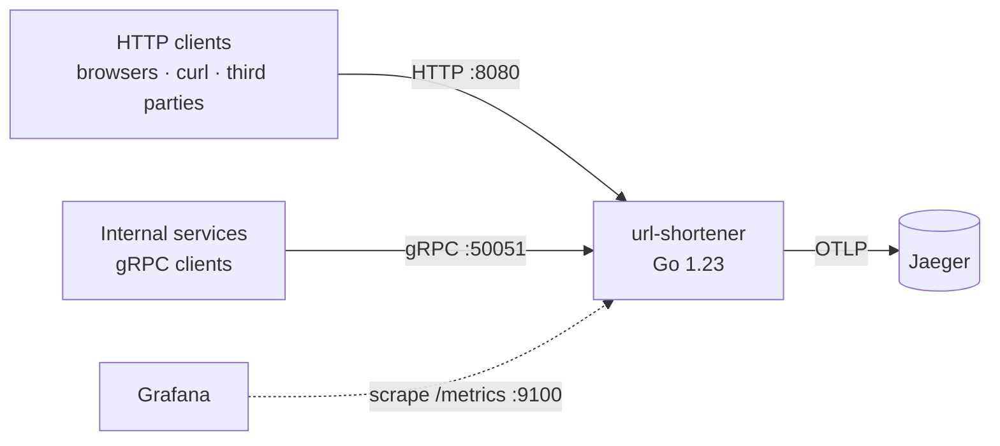
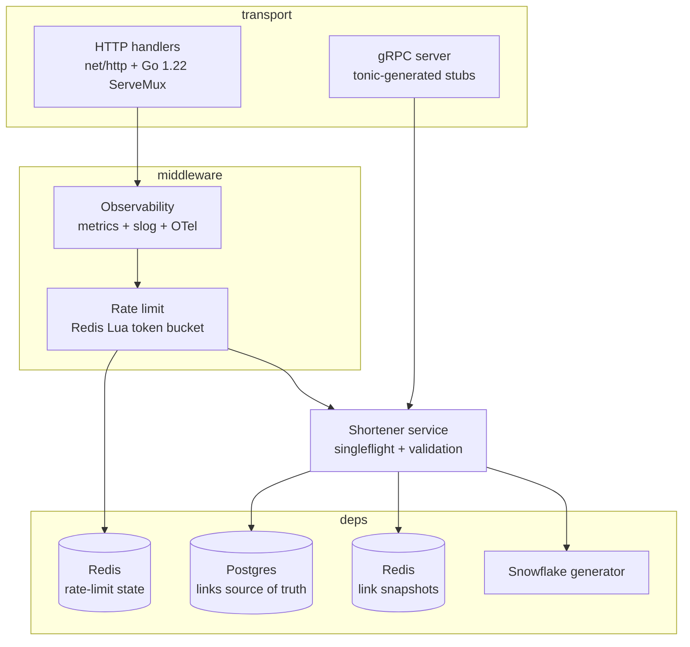
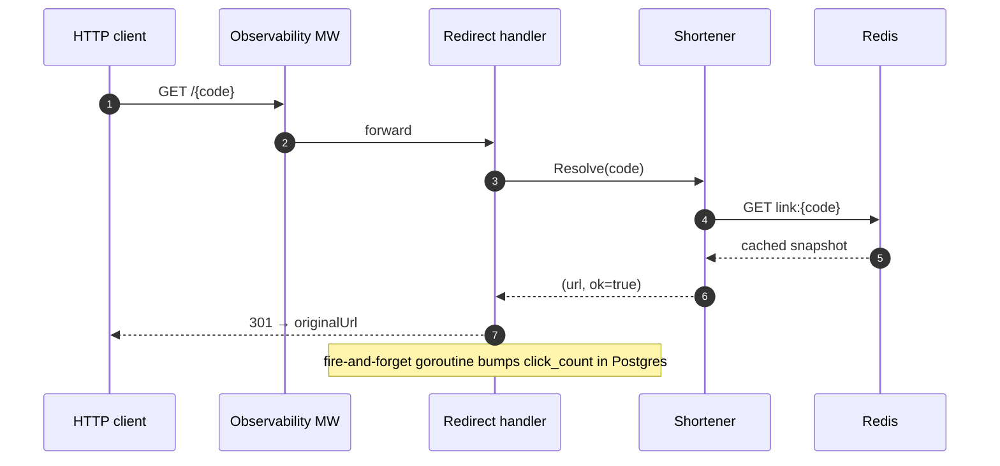
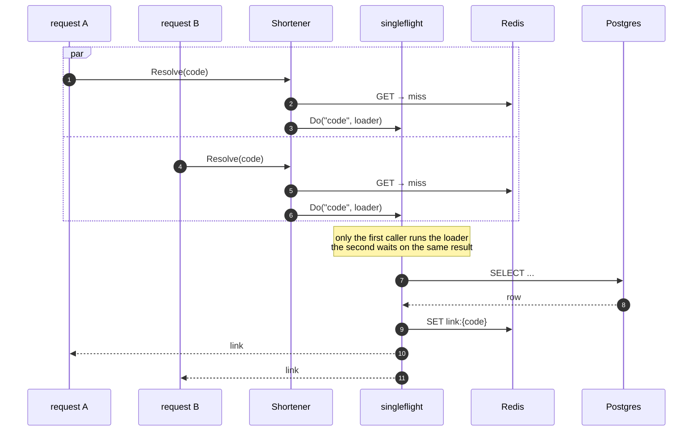
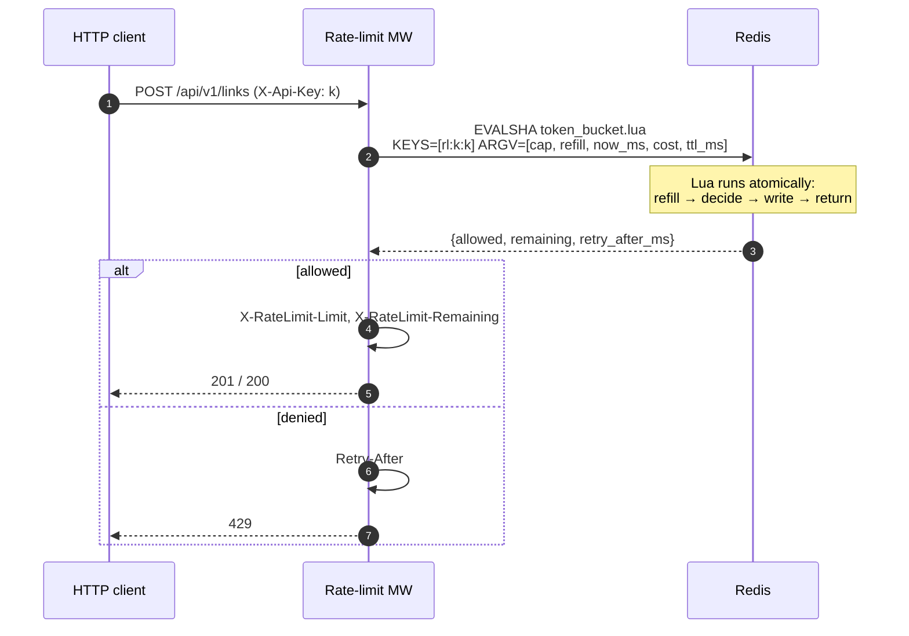

# Architecture

## C4 — Level 1: System Context

## C4 — Level 2: Containers (process-internal)

## Redirect flow (cache HIT — the fast path)

## Redirect flow (cache MISS — singleflight coalesces loaders)

## Rate limit flow

## Concurrency + backpressure

- **Snowflake generator** is guarded by a single mutex — cheap because operations are ~50 ns each.
- **Postgres pool** is bounded via `pgxpool` (`POSTGRES_MAX_CONNS`, default 20). Requests block on `Acquire` when the pool is exhausted — a natural backpressure signal.
- **Redis pool** is bounded (`REDIS_POOL_SIZE`, default 64). Both cache reads and rate-limit checks share it.
- **`ReadHeaderTimeout`** on both HTTP servers prevents slowloris.
- **Graceful shutdown** on `SIGTERM` / `Ctrl+C`: HTTP `Shutdown()`, gRPC `GracefulStop()`, tracing flush, with a bounded deadline (`SHUTDOWN_TIMEOUT`, default 15 s).

## Consistency model

- **Read** — cache-aside: cache never contains a link that Postgres doesn't. It may contain a stale copy for up to `CACHE_TTL` after a `DELETE`. Acceptable for a URL shortener; if not, pub/sub invalidation is one file away (roadmap).
- **Write** — Postgres is source of truth. Creation returns after the row is committed; cache backfill happens on the first read.
- **Rate limit** — Redis is authoritative. Cross-replica consistent by construction because Lua serialises per-key.
